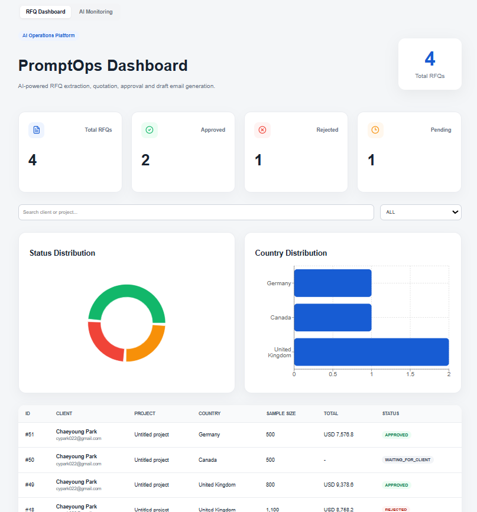
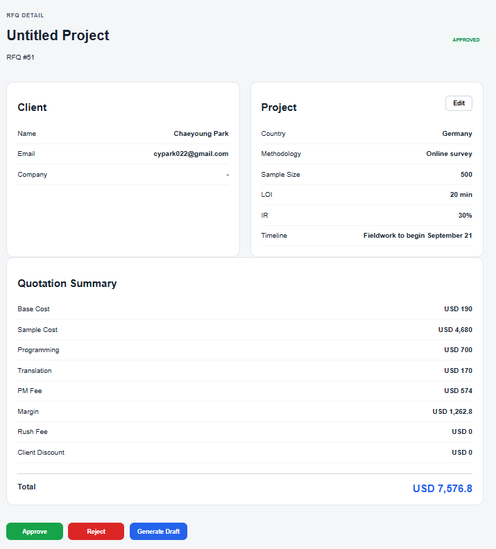
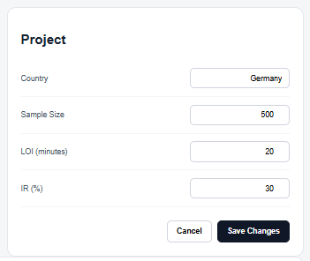
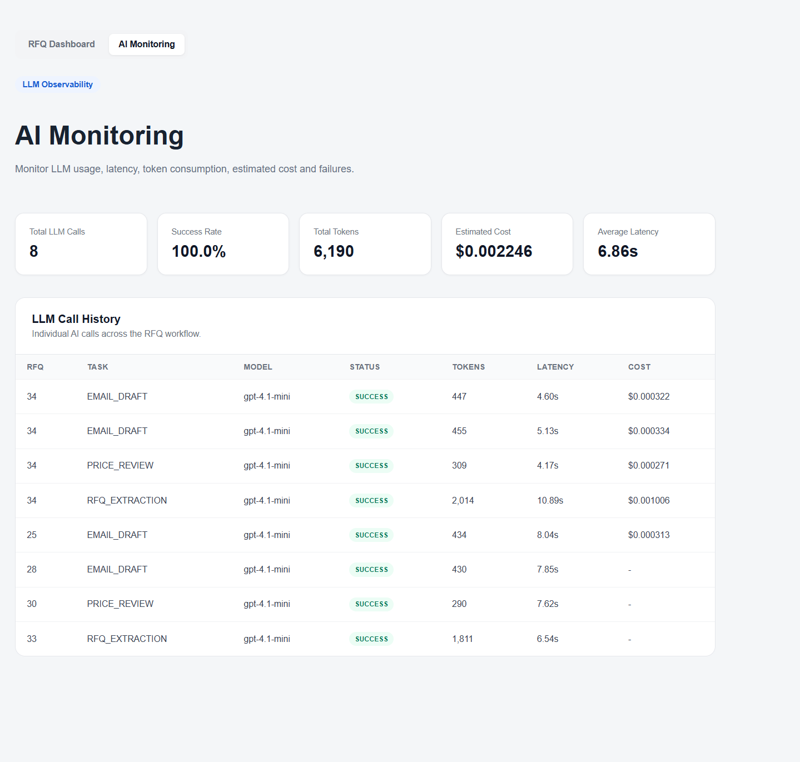

# RFQ Automation

**AI-assisted RFQ processing for market research operations.**

RFQ Automation turns incoming client emails into structured project requirements, rule-based quotations, human-reviewed decisions, and Gmail drafts. It combines an LLM for information extraction with Python pricing rules, workflow orchestration, and an operator dashboard.


## Key Features

- **Email intake & extraction:** Detect RFQ emails and extract project details using OpenAI structured outputs.
- **Validation & follow-ups:** Identify missing requirements and associate replies in the same Gmail thread with an existing RFQ.
- **Quotation & benchmark review:** Calculate prices with Python business rules and compare them with stored market reference data; flag cases without a suitable benchmark.
- **Human approval:** Let operators inspect and correct RFQ details, recalculate quotations, and approve or reject pricing before drafting a response.
- **Gmail drafts:** Prepare client-ready replies for final human review; emails are not sent automatically.
- **Evaluation & monitoring:** Compare extraction outputs with a Golden Set and log LLM usage, latency, failures, and estimated cost.

## Workflow

```text
Client RFQ Email
       ↓
   Gmail / n8n
       ↓
  LLM Extraction
       ↓
    Validation
       │
       ├── Missing Data → Clarification / Follow-up
       │
       └── Complete → Quotation
                           ↓
                    Benchmark Review
                           ↓
                     Human Approval
                           ↓
                       Gmail Draft
```

## Architecture & Tech Stack

| Component | Technology | Responsibility |
|---|---|---|
| Orchestration | n8n, Gmail, Slack | Email intake, workflow routing, approval notifications |
| Backend | Python, FastAPI, Pydantic | Validation, quotation APIs, workflow logic |
| AI | OpenAI API | Structured extraction and email drafting |
| Data | PostgreSQL, Supabase, SQLAlchemy, Alembic | RFQ records, pricing references, workflow state |
| Frontend | Next.js, TypeScript | RFQ review, editing, approval, monitoring |
| Local Environment | Docker Compose | Running application services |

The backend separates API, service, repository, and database responsibilities.

## Project Structure

```text
backend/
  app/          # API, services, database, prompts
  evaluation/   # Golden Set and extraction evaluation

frontend/       # Next.js dashboard
```

## Run Locally

**Prerequisites:** Git, Docker Desktop / Docker Compose, and credentials for the external services used by the workflow.

### 1. Clone the Repository

```bash
git clone https://github.com/chae0Park/rfq.git
cd rfq
```

### 2. Configure Environment Variables

Configure the required environment variables for:

- Backend and PostgreSQL database
- OpenAI API
- Gmail, Slack, and n8n integrations (when used)

Consult the repository configuration for the exact variable names.

**Important:** Keep API keys and credentials out of version control.

### 3. Start Docker Services

```bash
docker compose up --build
```

### 4. Access Local Interfaces

If the corresponding services and ports are enabled in the Docker Compose configuration:

| Service | Local URL |
|---|---|
| Dashboard | http://localhost:3000 |
| FastAPI Documentation | http://localhost:8000/docs |
| n8n | http://localhost:5678 |

> **Note:** Starting containers alone does not configure Gmail/Slack credentials, activate n8n workflows, or populate database reference data. These integrations require separate setup.

## Screenshots

### RFQ Dashboard



### RFQ Details & Quotation



### Editing & Recalculation



### LLM Monitoring



## Current Status & Limitations

The core RFQ workflow and supporting dashboard, evaluation, and monitoring components are implemented.

**End-to-end validation is still in progress**, particularly for:

- Complete and incomplete RFQ scenarios
- Multiple emails arriving close together
- Independent processing of concurrent RFQ requests

The multi-email concurrency issue should not be considered resolved until it is successfully retested.

This is a portfolio project, not a claim of production readiness.

External integrations require credentials and configuration. Quotation and benchmark results depend on the available reference datasets and human review.


